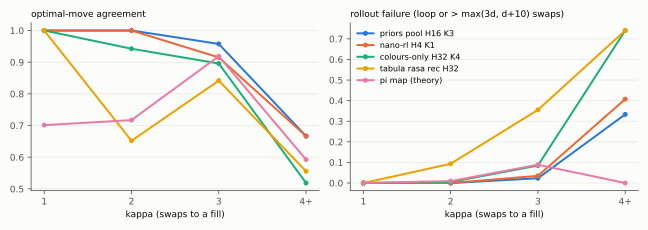
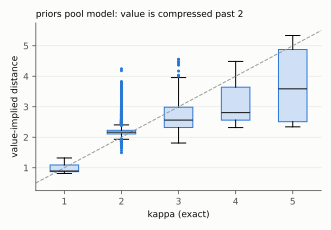
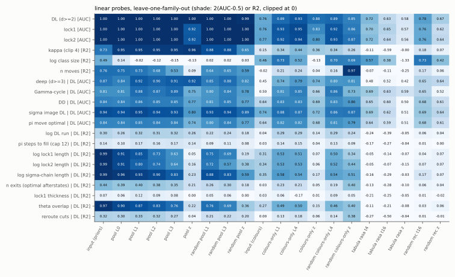
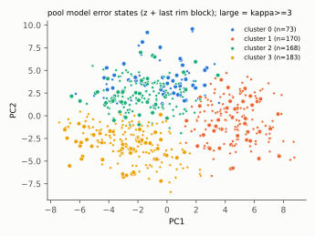

# Interpretability study 1: what the Maze Arena networks learned

13 October 2026. **Status: exploratory and post hoc throughout.** Every pattern below was found after looking at the data. The data are the arena's 16 census maps at one fixed hole each, plus 40 random splice variants of the held-out maps. Nothing here is evidence for a theorem, and no statement here should be cited as [computed] support for any conjecture of the theory team. Where a sentence says "always" or "never", it means "in these 38,263 states".

Scripts: `tools/arena_probe.js` (states, ground truth, network outputs, activations) and `tools/arena_probe_analysis.py` (probes, error analysis, figures). Outputs: `docs/interp1/` (`results.json` with every number quoted here, `examples.json` with the graphs and colourings of the named states, five SVG figures). No model was retrained or overwritten.

## Summary

1. **The decision the networks face at depth ≥ 2 is a single question: which way to turn.** Every unfilled state with κ ≥ 2 is doubly locked (DL), and every DL state has the same rim link pattern. Most remaining choices are between two rim rotations. A +3 rotation is R₊₃, the theory's π step. A +2 rotation is R₊₂, which is π⁻¹ on DL states. Read along the π-orbit, that is a step forward or a step backward along a run of DL states.
2. **The best model's direction errors all point the wrong way along that run.** The best model is `priors-gnn-h16-k3-pool`. Count its policy errors that play a rotation at a state where one end of the π DL run is strictly nearer: there are 10 (of 21 errors in all), and all 10 turn toward the *farther* end. The same holds for the other priors models: 10/10, 15/16, 11/12 and 7/7. Of the 250 deep non-Γ states with a strictly nearer end and an optimal rotation, the optimal set contains the nearer-end rotation in 231.
3. **The run position is the clearest candidate for a new variable.** Write (fwd, bwd) for the number of π-steps forward and backward to the first non-DL state. Then κ ≤ min(fwd, bwd) + 1 always holds, because π and π⁻¹ are single Kempe swaps. In this data the bound is tight for 88% of κ = 2, 47% of κ = 3 and 21% of κ ≥ 4 DL states. No network represents the run position: a linear probe of DL-run length reaches R² ≤ 0.33, and π-steps-to-fill reaches R² ≤ 0.17, at every layer of every model.
4. **Most of what can be decoded linearly is in the input, or is produced by message passing whether or not the net is trained.**
   - The priors nets get the locks and the chain lengths as input features.
   - A random-initialised net of the same architecture decodes κ about as well as the trained one at layer 0 (R² 0.95 for both). It also matches the trained net on the locks (AUC 1.00) and on chain membership.
   - The training-specific gain sits in the MLP layer z: deep-vs-κ=2 AUC goes from 0.82 at random init to 0.92 trained, with similar gains for Γ-cycle membership and DD. Unit z.12 alone correlates r = 0.43 with "κ ≥ 3 given DL".
5. **Value errors are a compression toward κ = 2, and named features find where they happen but not their size.** The value head says about 2.2 for κ = 2 states and about 2.6–2.8 for κ = 3–5 (Figure 2).
   - Named theory features predict *where* value errors happen (AUC 0.90, leave-one-family-out), but not their size (residual R² ≈ 0.01).
   - Errors are 6–9 times more likely at states with a single exit, at states whose exits avoid the rim entirely, and at states on Γ-cycles.
   - Clustering the error states' activations separates them by error sign and by the rim degree word read from the repeat index (cluster purity 0.59 against 0.31 by chance). No cluster isolates a new chain property.
6. **One small seed map fools every priors model.** `c30~s28` (18 vertices, 68 states, one Kempe class, κ up to 4) is a two-splice variant of c30. All its deep states sit in one DL run of length 15 on one π-orbit, and every decision there is "turn +2 or +3". Together with the r210 family, it holds all 16 states that 4 or more of the 6 chain-feature models get wrong.

## 1. Data and methods

**Models.** These are all 10 committed models in `models/index.json`, read from `docs/arena/models/` because `lab/` has been moved to `docs/` in the current working tree; the files are byte-identical to `HEAD:lab/arena/models/`.
- Afterstate agents score each swap as −1 + γ·V(after), with V = 0 at a fill. This is exactly `ARENA.netAgent`, with γ taken from each model file: 1 for the pool and tabula-rasa models, 0.97 for the others.
- The value-implied distance is d̂ = −V for γ = 1, and the inverse of −(1−γ^d)/(1−γ) otherwise.
- Controls:
  - a random-initialised network (seed 777) of each probed architecture;
  - the encoder's own features, pooled like a hidden layer ("input (priors)" with chain features, "input (colours)" without);
  - shuffled labels.

**State sets.**
- **Census.** These are all 30,376 unfilled states of the 16 four-colour maps, by full enumeration. They match the census distances exactly. Train maps: w9 w13 w18 ico p22 r1 r178 p32r111 p31r12. Test maps: c30 p32r11 p34r28 c60 six trap17 r210.
- **Splice.** These are 1–3 random splices of the *test* maps, which no model trained on. Seed 1 gave 73 attempts, of which 40 maps were kept because they have states with κ ≥ 3. From each kept map the sample takes every κ ≥ 3 state, up to 150 states at κ = 2 and up to 60 at κ = 1, for 7,887 states in all. This is a declared sample, not a census.
- **Probe grouping.** Probes are held out by *family*: a census map together with its splice variants. That gives 16 folds.

**Ground truth.** All of it is exact, computed per state.

| quantity | definition used | source |
|---|---|---|
| κ | fewest whole-component Kempe swaps to a link of ≤ 3 colours, hole fixed (= the arena distance d) | START-HERE §5–6 |
| ℓ | fewest mixed moves: Kempe swaps plus singleton slides h→u (c(u) unique on N(h)); the hole moves | `longtable/wp19/beyond-short-fill.md` |
| m(T) | **not computable here.** m(T) = min over (v, τ) of max over T\*-starts of ℓ needs every degree-5 hole and fan. **Proxy:** max ℓ over all unfilled states at the arena's one hole | LongTableNextAttack §84 |
| j, Lock1, Lock2, DL | `RepeatAt`, `Lock1`, `Lock2`, `DoublyLocked` | `QuarterFloor.lean` |
| π, λ | `piMove`: R₊₃ / φ_B⁻¹ / φ_A / τ by Lock2 or M3, with λ = +1 / −1 / −1 / −3 | `QuarterPi.lean` |
| π-cycle ("π-loop"), winding, Γ-cycle | orbit of π, length L, F filled states, w = (L − 4F)/5; Γ = an all-DL orbit | NightLog, Theorem W |
| DD, σ-image | DD: DL and π(s) DL. σ(s) = swap of the {α,μ}-component of x_{j+1}; whether σ(s) is DL or lockless | `QuarterSigmaGroups.lean` |
| Kempe class | connected component of the swap graph over all colourings, filled states included | |
| rim link pattern ("gear polarity") | four bits for the non-trivial rim pairs a two-colour chain can join: L1 (m–a in {μ,A}) and L2 (m–b in {μ,B}) join *different* colours (odd ring with the two spokes); PA (x_j–x_{j+2} in {α,A}) and PB (in {α,B}) join the *repeated* colour (even ring). Adjacent rim pairs are always joined, so they carry no information | this study |
| chain lengths | component sizes of the lock chains, the σ chain, the {α,A}/{α,B} chains at x_j and x_{j+2}, and the {A,B} chain at a | |
| run position (new) | fwd / bwd = π-steps forward / backward to the first non-DL state; run bound = min(fwd, bwd) + 1 | this study |
| lock thickness (new) | number of internally vertex-disjoint m–a (m–b) paths inside the lock component | this study |

Checks made on every map, including the splice maps:
- π is a permutation of every Kempe class.
- Σλ = L − 4F, and 5 divides L − 4F, on every π-orbit (the Theorem W bookkeeping).
- κ ≤ run bound on every probed DL state.

ℓ was computed by bounded mixed BFS for every census state with κ ≥ 3, and for the first 300 such states overall. For κ ≤ 2, ℓ = κ by the compiled short-fill theorem. For κ = 3 the BFS confirms that no mixed fill of length ≤ 2 exists, as that theorem requires.

**Compute.** One core per run. MacBook on AC for the main run; the battery fell from 41% to 23% while other jobs were running, so a later refresh was limited to the GNN models.

| run | time |
|---|---|
| main probe | 13.5 min |
| GNN refresh | 2.7 min |
| analysis | ~1 min |

**Limitations.**
- There is one hole per map and one orientation; π-cycles depend on orientation.
- There are only 344 states with κ ≥ 3 (107 of them in the census).
- Probes are linear (ridge, α = 30 on standardised activations; α = 10 for node probes).
- Mutual information uses 10 quantile bins.
- The tabula-rasa models' first-run files lack the refreshed margin fields; their choices are unaffected.

## 2. Ground-truth structure (sanity checks and context)

- **κ ≥ 2 ⇔ DL**, with 11,810 of 11,810 states agreeing. This is Kempe's argument.
- **The rim link pattern is fixed by the two locks.** Only four of the sixteen patterns occur: 0011, 0101 and 1010 at κ = 1, and 1100 at every κ ≥ 2. This is the Hex dichotomy (L1 ⇔ ¬PB, L2 ⇔ ¬PA; formal as `kempe_hex`). So rim-chain parity carries no information beyond the locks, and **at κ ≥ 2 every state shows the same rim picture**. Depth is invisible on the rim.
- **λ is +1 on every DL state**, because every DL state is an R₊₃ step. So λ carries no information at κ ≥ 2.
- **κ ≥ 3 forces DD and a DL σ-image**, with 344 of 344 states agreeing. This follows by construction: π(s) and σ(s) are single swaps, so if either were non-DL the state would have κ ≤ 2. By the same argument every κ ≥ 3 state sits in a DL run of length ≥ 3. **These "theory features" therefore contain one step of lookahead, and their high predictive power for depth is partly built in.** A depth model on static colouring features (no swap applied) gets AUC 0.83 for "κ ≥ 3 given DL". With π/σ/class features it gets 0.98.
- **Deep states sit on long DL runs** (Figure 5). Among DL states, the share with κ ≥ 3 is:

| DL run length | share with κ ≥ 3 |
|---|---|
| ≤ 2 | 0% |
| 3–4 | 3.8% |
| 5–9 | 17% |
| ≥ 10 | 35% |

- **Γ-cycles** (all-DL π-cycles, all with positive winding) occur on r1, c30, p32r111, p31r12 (2), p32r11 and p34r28 (2), and not on r178, r210, six or trap17. Γ-cycle DL states are deep 23% of the time, against 2.6% for other DL states, but no κ ≥ 4 state lies on a Γ-cycle. c30 (order 17, all-5 link) has one; this agrees with "Lemma N: first positive π-cycle at order 17" in the night log.
- **ℓ against κ.** The max-ℓ proxy for m(T) is 4 on every map that has κ ≥ 4.

| κ | ℓ observed |
|---|---|
| 3 | 3 (268 states) |
| 4 | 3 (11), 4 (15) |
| 5 | 3 (5) |
| 6 | 4 (1) |

  So κ − ℓ ≤ 2 everywhere, consistent with the WP19 observation at orders 21–24. This is post hoc, small and orientation-specific, and is not evidence for M1 or for any bound.
- **Lock thickness.** 98% of DL states have both lock chains with a cut vertex; no state has both locks thick. The 348 states with a thick lock (≥ 2 vertex-disjoint paths) are all at κ = 2; about 10 would be expected deep if thickness were independent of depth.

## 3. Behaviour

Held-out states (test + splice maps). Columns: optimal-move agreement; rollout failure (a loop, or more than max(3κ, κ + 10) swaps); mean optimality gap (steps − κ) over successful rollouts. n = 8,438 / 259 / 27 states at κ = 2 / 3 / ≥ 4.

| model | κ = 2 agree | κ = 3 agree / fail / gap | κ ≥ 4 agree / fail / gap |
|---|---|---|---|
| priors-gnn-h16-k3-pool | 1.000 | 0.958 / 0.023 / 0.04 | 0.667 / 0.333 / 0.22 |
| mid-rl | 1.000 | 0.938 / 0.019 / 0.05 | 0.593 / 0.556 / 0.17 |
| mid-pretrained | 1.000 | 0.961 / 0.023 / 0.02 | 0.519 / 0.630 / 0.10 |
| mid-zero-shot | 1.000 | 0.645 / 0.232 / 0.20 | 0.741 / 0.333 / 0.33 |
| tiny-rl | 1.000 | 0.938 / 0.042 / 0.02 | 0.444 / 0.481 / 0.29 |
| nano-rl (679 params) | 1.000 | 0.915 / 0.035 / 0.06 | 0.667 / 0.407 / 0.25 |
| colours-only-rl | 0.914 | 0.900 / 0.058 / 0.27 | 0.519 / 0.630 / 1.10 |
| colours-only-pretrained | 0.942 | 0.896 / 0.085 / 0.16 | 0.519 / 0.741 / 0.29 |
| tr-rec-h16-t24 (value agent) | 0.655 | 0.842 / 0.463 / 0.44 | 0.667 / 0.667 / 0.33 |
| tr-rec-h32-t16 (value agent) | 0.652 | 0.842 / 0.355 / 0.69 | 0.556 / 0.741 / 0.86 |
| random-init pool architecture | 0.823 | 0.849 / 1.000 / – | 0.778 / 1.000 / – |
| π map (follow `piMove`) | 0.717 | 0.919 / 0.085 / 1.70 | 0.593 / 0.000 / 2.67 |

- The hard regime is κ ≥ 4. There the best model fails a third of rollouts by looping, and agreement drops to 0.52–0.74 for every model.
- At κ ≤ 3 the chain-feature models are essentially optimal; the full gap histograms are in `results.json` under `gapHist`.
- The π map is a canonical theory policy and is surprisingly good at κ = 3 (0.92 agreement). It fails only on Γ-cycles, where π never fills, and it is slow (mean gap 1.7–2.7) because it never turns back.





## 4. What is decodable, and where

Linear probes, held out by family, are in Figure 3; the full table is under `probe` in `results.json`. Shuffled-label controls give AUC 0.44–0.56 and R² ≈ 0.



| feature | priors pool (best layer) | same arch, random init | input features | colours-only (best) | colours-only, random init |
|---|---|---|---|---|---|
| DL / locks (AUC) | 1.00 (input) | 1.00 | 1.00 | 0.93–0.95 | 0.90–0.93 |
| κ, clip 4 (R²) | 0.96 (z) | 0.95 (L0), 0.65 (z) | 0.73 | 0.44 | 0.36 |
| κ ≥ 3 given DL (AUC) | **0.92 (L1, z)** | 0.88 (L3), 0.82 (z) | 0.87 | 0.79 | 0.81 |
| Γ-cycle given DL (AUC) | 0.89 | 0.85 | 0.81 | 0.89 | 0.88 |
| σ-image DL given DL (AUC) | 0.95 | 0.94 | 0.94 | 0.88 | 0.88 |
| DL-run length (R²) | 0.32 | 0.27 | 0.30 | 0.33 | 0.33 |
| π-steps to fill (R²) | 0.17 | 0.15 | 0.14 | 0.16 | 0.16 |
| number of exits (R²) | 0.40 | 0.35 | 0.44 | 0.25 | 0.23 |
| lock thickness (R²) | 0.12 | 0.07 | 0.07 | 0.07 | 0.09 |
| theta overlap \|K1 ∩ K2\| (R²) | 0.90 (L0) → 0.22 (z) | 0.92 | 0.97 | 0.51 | 0.50 |

Readings:
- **Most of the linearly decodable information is in the input, or arises from untrained message passing.** The priors nets receive lock reach and chain sizes as features. Chain lengths and the theta overlap decay layer by layer and are nearly gone at z (R² 0.05–0.23), so the trained readout discards them.
- **What training adds sits at z.** Comparing random-init z with trained z: "κ ≥ 3 given DL" goes 0.82 → 0.92, κ goes 0.65 → 0.96, and Γ / DD gain about +0.05 over the best random layer. This is the value function's own target and its close relatives.
- **Node level (colours-only nets, which get no chain features).** Whether a vertex lies on a lock chain, given that it has the chain's colours, is decodable at 0.85–0.88 AUC by layer 3. The input gives 0.62. **A random-initialised net of the same architecture reaches 0.82–0.90.** So chain membership is a by-product of mean-neighbour message passing, not something the training discovered. Chain size is not decodable at node level (R² ≤ 0.29).
- **The tabula-rasa recurrent net** (raw colours, weight-tied, T = 16) is *less* linearly decodable across families than its own random initialisation. For example, κ gets R² −0.6 at t = 8–16, against +0.19 at random init. Its features do not transfer across map families, which matches its weak held-out value agreement. Relative-colour node targets are not meaningful for this net, because it never sees which colour is repeated.
- **Not represented anywhere:** π-run position (fwd/bwd), π-steps to fill, lock thickness, and the number of exits. These are exactly the quantities that separate the error states (§5).

Single units: in the pool net, z.27 and z.15 track DL / κ at r ≈ 0.97–0.99 (essentially the input lock bits). z.12 (r = 0.43) and z.25 (r = 0.40) are the only units above r = 0.35 in correlation with "κ ≥ 3 given DL" (MI 0.04–0.05 bits). nano-rl's best unit for depth is z.1 (r = 0.29).

## 5. Error analysis

### 5.1 Value errors (pool model; DL states; |d̂ − κ| ≥ 0.5)

| κ | errors / states | mean d̂ − κ | over-optimistic share |
|---|---|---|---|
| 2 | 410 / 11,466 | +0.19 | 0.2% |
| 3 | 153 / 308 | −0.29 | 83% |
| 4 | 20 / 29 | −0.94 | 100% |
| 5 | 3 / 6 | −1.28 | 100% |

The value function behaves like a two-level detector, κ = 2 versus "more", with a compressed scale above 2 (Figure 2).

**What the named features explain** (leave-one-family-out, DL states):
- They flag error-prone states well: AUC 0.896 with named features, 0.896 with candidates added, 0.905 with κ added.
- They do not predict the residual d̂ − κ: R² −0.02 named, 0.01 with candidates, 0.20 only once κ itself is added.

Error rates within one depth (value errors / states):

| condition (κ = 2 states) | condition holds | condition fails |
|---|---|---|
| single exit (one distinct optimal afterstate) | 105 / 481 = 22% | 305 / 10,985 = 2.8% |
| every exit avoids the rim (interior-only exits) | 18 / 60 = 30% | 392 / 11,406 = 3.4% |
| on a Γ-cycle | 23 / 132 = 17% | 387 / 11,334 = 3.4% |
| lock 1 thick (≥ 2 disjoint paths) | 0 / 181 | 410 / 11,285 = 3.6% |
| run bound not tight | 112 / 1,320 = 8.5% | 298 / 10,146 = 2.9% |

### 5.2 Policy errors: the rotation-direction failure

The pool model makes 21 policy errors on DL states, all at κ ≥ 3: 12 at κ = 3 and 9 at κ = 4. When it errs, the chosen afterstate scores a median 0.14 above the best optimal one; there are no exact ties between distinct afterstates. Grouping each error by the repeat-index shift of the chosen move against the shifts of the optimal moves:

| chosen vs optimal shifts | count | reading |
|---|---|---|
| +2 vs {+3}, +3 vs {+2} | 10 | wrong rotation direction |
| 0 vs {0, +2, +3} | 6 | a lock-cutting swap that keeps the repeat index, when every kind of move was available |
| other | 5 | mixed |

Rotation errors (+2 or +3 played) at states where one run end is strictly nearer: for the pool model all 10 turn toward the farther end. The same pattern holds across the priors models:

| model | toward the farther end / rotation errors with a strictly nearer end |
|---|---|
| nano-rl | 7/7 |
| mid-rl | 10/10 |
| mid-pretrained | 11/12 |
| tiny-rl | 15/16 |
| colours-only-pretrained | 303/377 |
| mid-zero-shot | 14/22 |

mid-zero-shot (pretrained only, never trained on level maps) is the exception: it is close to random on direction.

### 5.3 Clusters of error states

k-means (k = 4) on the error states' z and last-layer rim activations, first 8 principal components; Figure 4.

| cluster | size | κ | mean d̂ − κ | top relative degree words |
|---|---|---|---|---|
| 0 | 73 | 26 at 2, 47 at 3 | −0.18 (over-optimistic) | 65675, 65666, 66666 (mostly r210) |
| 1 | 170 | 129 at 2, 41 at 3 | +0.37 | 75575, 57575, 75566 (degree 7 at x_j or x_{j+2}) |
| 2 | 168 | 126 / 34 / 8 | +0.49 | 66666, 55667, 57558 |
| 3 | 183 | 129 / 36 / 15 / 3 | +0.48 | 66666, 65666, 57558 |

- Cluster purity given the relative degree word is 0.59, against 0.31 by chance. The clusters are organised by **error sign** and by **rim geometry** (the hole's degree word read from the repeat index), not by any chain quantity.
- Compared with all DL states of the same depths, every cluster has longer DL runs (4–7 vs 2.3), fewer distinct exits (2.2–3.7 vs 4.4) and fewer moves (5.7–9.4 vs 10).
- Of the 594 pool-model errors, 83 are unexplained in the sense that the named-feature model scores them below the 75th percentile of DL states. 47 of those 83 fall in cluster 1, the degree-7-at-the-repeat geometry.
- The colours-only model's 5,803 errors form five clusters of the same kind (purity 0.41 against 0.22). This model also has a large population of κ = 2 policy errors (678) that the named features predict only moderately (AUC 0.84).



### 5.4 Consensus-hard states and concrete examples

There are 16 states that 4 or more of the 6 chain-feature models get wrong. All are on r210 (census), its splices `r210~s20` and `r210~s55`, `c30~s28` or `p32r11~s36`. All have a single exit or two exits, DL runs of length 6–15, and no Γ-cycle. Graphs, colourings and full move lists are in `docs/interp1/examples.json`.

Colouring strings list vertices 0..n−1, skipping the hole, with colours renamed by first occurrence. Moves are described relative to the repeat index j.

- **`c30~s28`** (c30 + flip + insert; n = 18; link degrees 75556; 68 colourings in one class; 4 states at κ = 4, 5 at κ = 3). All 9 deep states lie on one π-orbit (L = 28, F = 7), in a single DL run of 15; fwd + bwd = 16 at each. In the middle of the run, shortcuts beat the run bound: at (8, 8), κ = 3. Every deep state has 2–3 distinct moves: +2, +3, and sometimes 0. Examples:
  - `01231323020102133`: κ = ℓ = 4, run (fwd, bwd) = (3, 13). The optimal move is the +3 rotation, toward the near end. 6 of 6 priors models play +2, and the pool model then loops.
  - `01232323010101323`: κ = ℓ = 3, run (14, 2). The optimal move is +2; 6 of 6 models play +3 or 0.
  - The value heads disagree widely on this map: at the κ = 4 state `01231323020101323`, d̂ ranges from 2.0 to 4.9 across the six chain-feature models.
- **r210** `012123230302301010231010232312310` (census, test map): κ = ℓ = 4, run (4, 8). The only optimal afterstate is the π move (R₊₃, +3), toward the near end. The pool model plays the +2 swap ({α,B} at x_{j+2}, size 4) into a κ = 5 state. 5 of 6 models err here.
- **r210** `012132302032021012301312323012013`: κ = 4 but ℓ = 3 (a slide shortens it). Run (6, 6); the only optimal move is a 0-shift σ swap ({α,μ}, size 14). The models rotate instead.
- **p31r12** `012323202310103012102323213101` (census, training map): κ = 3, on a Γ-cycle (L = 20). The pool model picks a size-2 interior {α,A} cut that stays at κ = 3; the π move was optimal. The score difference is 0.013.

## 6. Candidate new variables

Each is defined exactly in the scripts. All are post hoc.

1. **Run position ρ(s) = (fwd, bwd).** The π-steps forward and backward to the first non-DL state on the π-orbit; −1 on a Γ-cycle.
   - The run bound min(fwd, bwd) + 1 ≥ κ holds trivially.
   - It is tight for 88% / 47% / 21% of κ = 2 / 3 / ≥ 4 DL states.
   - The nearer-end direction is optimal in 231 of 250 deep non-Γ states that have a strictly nearer end.
   - Every rotation error of the best model at such a state turns toward the farther end (10/10).
   - It is not linearly present in any network.
2. **Exit multiplicity E(s).** The number of distinct afterstates at κ − 1. E = 1 multiplies the value-error rate by about 8 at κ = 2. All consensus-hard states have E ≤ 2.
3. **Interior-only exits.** Every optimal swap avoids the five rim vertices. Rare (60 states at κ = 2), but the error rate there is 30%. This matches the level team's observation that "the helpful chain often does not touch the rim".
4. **Lock thickness.** Vertex-disjoint path count of each lock chain. A thick lock never occurs at κ ≥ 3 here (0 of 348 thick states, with about 10 expected), and never produces a value error. Not represented by any network.
5. **Rim degree word relative to the repeat index.** For example, a degree-7 vertex at x_j or x_{j+2}. This organises the error clusters. It is map geometry, and the networks clearly condition on it.
6. **Shortcut count (κ < run bound).** States where some non-π swap beats walking the run. This is where the π-run picture stops and cross-orbit moves (σ, lock-breaking cuts) matter; it is the analogue of the night log's "transport to another π-cycle".

## 7. Proposals

These are all exploratory, and none is a claim.

1. **Theory team: run bound versus shortcut.** The quantity κ ≤ min(fwd, bwd) + 1 is a trivially valid bound that links κ, which the arena cares about, to the π-orbit structure behind Theorem W. Two questions:
   - When is it tight, and what local configuration creates a shortcut (κ < bound)? Is the shortcut always a σ-link or a lock-breaking exit into another π-orbit, as in the transport statement?
   - Is "a deep state must sit inside a DL run of length ≥ 3" the only depth constraint that π gives, or do run length and Γ-membership force more? Run length ≥ 10 here gives 35% deep.
   
   This could be measured on the existing census orders 12–27 with the Studio π engine. It needs a declaration first; this report is not one.
2. **Theory team: thick locks.** "A lock chain with two vertex-disjoint paths forces κ ≤ 2" held in 348 of 348 states here. It is cheap to try to kill on the census, and if it survives it is a crisp local lemma candidate: a thick lock cannot be cut by one swap, so the exit must be a rotation. It is post hoc on one small data set.
3. **Level generation: corridors, not depth.** Score a map by its *decision* states rather than its deepest state. A decision state is a DL state where exactly one of the +2 / +3 directions is optimal and E ≤ 2, weighted by |fwd − bwd| being small relative to the run length, so the nearer end is not obvious. `c30~s28` is a natural seed: 18 vertices, readable, all six chain-feature models fail on it. Grow it with splices that keep the DL run long and the exit single. The bare `c30~s28` is also a small object for the theory team: one class, 68 colourings, one long DL run.
4. **Agent training (exploratory).**
   - Add an auxiliary head that predicts (fwd, bwd), or give the arena a "run-position" feature, and test whether direction errors vanish.
   - Oversample single-exit and interior-exit states.
   - Add a "π-run nearer-end" rule to the duel roster: walk π forward and backward to the nearest non-DL state and turn that way. It is the theory's own machinery, so its failures (Γ-cycles, shortcuts) are interpretable by construction.
5. **Interpretability next step.** Compare the trained colours-only net with the random-init net on *behaviour* rather than on probes. The probes show that chain membership comes free with message passing, so the learned part must be in how z combines it. A causal test, such as ablating z.12 or z.25 in the pool net and measuring direction errors, would show whether those units carry the deep-state signal or only correlate with it.

## Reproduce

```
node tools/arena_probe.js --out <dir> --ell-cap 60000 --ell-max-states 300   # about 14 min on one core
python3 tools/arena_probe_analysis.py --data <dir> --out docs/interp1         # about 1 min; numpy + matplotlib
```

`--quick` runs the census only with two models (about 20 s). Every number quoted above is in `docs/interp1/results.json`, and the named states are in `docs/interp1/examples.json`.
